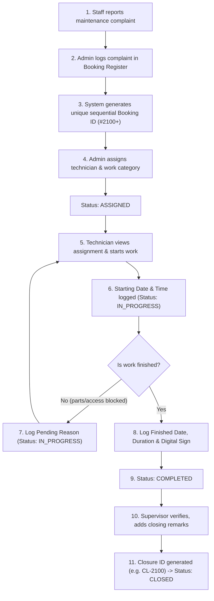

# Register-Based Maintenance Management System (CMMS)

[](https://spring.io/projects/spring-boot)
[](https://www.oracle.com/java/)
[](https://reactjs.org/)
[](https://www.typescriptlang.org/)
[](https://www.postgresql.org/)
[](https://mui.com/)
[](LICENSE)

A digitized, enterprise-grade **Register-Based Maintenance Management System** designed to directly replace handwritten physical maintenance registers, manual work ledgers, and printed work orders with a modern, fully-auditable, digital workflow.

---

## 📋 Table of Contents

- [Overview & Core Concept](#-overview--core-concept)
- [Key Modules & Registers](#-key-modules--registers)
  - [1. Maintenance Booking Register](#1-maintenance-booking-register)
  - [2. Maintenance Work Register](#2-maintenance-work-register)
  - [3. Maintenance Work Order Form (Printable)](#3-maintenance-work-order-form-printable)
  - [4. Maintenance KPI Dashboard](#4-maintenance-kpi-dashboard)
- [Work Order Lifecycle & Workflow](#-work-order-lifecycle--workflow)
- [User Roles & Access Control](#-user-roles--access-control)
- [Search, Filters & Reporting](#-search-filters--reporting)
- [System Architecture & Tech Stack](#-system-architecture--tech-stack)
- [Database Schema](#-database-schema)
- [Quick Start / Local Setup](#-quick-start--local-setup)
- [Default Login Credentials](#-default-login-credentials)
- [REST API Reference](#-rest-api-reference)
- [Repository & Contributions](#-repository--contributions)

---

## 🎯 Overview & Core Concept

Traditional facility and estate maintenance operations rely heavily on physical paper logbooks:
1. **The Booking Logbook** at the reception/facilities desk where complaints are logged by hand.
2. **The Work Register** kept by maintenance supervisors where technician dispatches, pending parts, and completion times are recorded.
3. **The Physical Work Order Slip** carried on clipboards by technicians, filled out with pencil/pen and signed upon job completion.

This system **digitally reproduces every single column, field, and workflow of those physical registers**, while adding:
- **Sequential Auto-Incremented Booking IDs** (starting at `#2100`)
- **Real-Time Lifecycle Tracking**: `PENDING` ➔ `ASSIGNED` ➔ `IN_PROGRESS` ➔ `COMPLETED` ➔ `CLOSED`
- **Supervisor Verification & Closure Codes** (e.g., `CL-2100`)
- **Digital Technician Signatures** via interactive touch/mouse canvas
- **One-Click Excel (.xlsx) & Formatted PDF/Print Exports**
- **Unified KPI Dashboard** with real-time analytics across buildings, technicians, and categories

---

## 📑 Key Modules & Registers

### 1. Maintenance Booking Register
**Route:** `/app/maintenance-booking-register`

Digitally captures complaints and requests directly from reporters, staff, or desk operators.

| Column Name | Type | Description |
|---|---|---|
| **S.No** | Auto | Sequential row number |
| **Booking ID** | Auto / Unique | Sequential identifier (e.g., `2100`, `2101`, `2102`) |
| **Date & Time** | Date-Time | Timestamp when complaint was filed |
| **Reported By** | Text | Name of the person reporting the issue (e.g., `Nandhini`, `Chandramohan`) |
| **Location Details** | Structured | Building, Floor, Room, or exact location (e.g., `B1 – Ground Floor`, `B1 – Second Floor`) |
| **Complaint Details** | Text | Detailed description of the breakdown/leakage/damage |
| **Booking Status** | Badge | `PENDING`, `ASSIGNED`, `IN_PROGRESS`, `COMPLETED`, `CLOSED` |
| **Actions** | Action Buttons | View Details, Assign Tech, Record Work, Export, Print |

**Features:**
- Quick-filter tabs: *All, Pending, Assigned, In Progress, Completed, Closed*
- Live search across Booking ID, Reported By, Location, and Complaint Details
- Export register to formatted **Excel (`.xlsx`)**
- Formatted **Print layout** matching official tabular book format

---

### 2. Maintenance Work Register
**Route:** `/app/maintenance-work-register`

Records the actual maintenance work performed against any existing complaint booking.

| Column Name | Type | Description |
|---|---|---|
| **S.No** | Auto | Sequential work record entry number |
| **Booking ID** | Selection | Dropdown selector linked directly to active Booking Register items |
| **Type of Work** | Category | Plumbing, Electrical, HVAC, Carpentry, Masonry, General |
| **Attended By** | Text / Selection | Assigned technician or maintenance staff name |
| **Starting Date** | Date-Time | Timestamp when work officially commenced on-site |
| **Finishing Date** | Date-Time | Timestamp when work was completed |
| **Time Spent** | Minutes / Hours | Duration taken to resolve (e.g., `45 mins`, `2.5 hours`) |
| **Pending Reason** | Text / Enum | If incomplete: `Awaiting Spare Parts`, `Specialist Required`, `Site Inaccessible`, etc. |
| **Closed ID** | Code | Formal closure reference number (e.g., `CL-2100`) generated upon supervisor closure |
| **Signature** | Digital Canvas | Verified digital technician signature thumbnail |

**Features:**
- Auto-retrieves complaint description and location upon selecting a Booking ID
- Supports **multiple progress updates** for a single booking (full maintenance audit trail)
- Interactive **digital signature pad** for technicians to sign on mobile, tablet, or desktop
- Automatic booking status transitions based on work activity

---

### 3. Maintenance Work Order Form (Printable)
**Route:** `/app/maintenance-work-order-form`

An authentic, pixel-perfect digital reproduction of the physical paper **MAINTENANCE WORK** slip.

```
+---------------------------------------------------------------------------------------+
|                                    MAINTENANCE WORK                                   |
|  Form No: 2100                           Date: 01/07/2026           Name: Nandhini    |
+------+------------+---------------+----------------------+------------+---------------+-------+
| S.No | Booking ID | Starting Date | Work Details         | Booking By | Finished Date | Sign  |
+------+------------+---------------+----------------------+------------+---------------+-------+
|  1   | 2100       | 01/07/2026    | Water tap replaced   | Nandhini   | 01/07/2026    | [✓]   |
|  2   | 2101       | 01/07/2026    | Pipe gasket fixed    | Chandra    | 01/07/2026    | [✓]   |
+------+------------+---------------+----------------------+------------+---------------+-------+
| Technician Signature: [_______________]        Supervisor Signature: [_______________]|
+---------------------------------------------------------------------------------------+
```

**Features:**
- Multi-row entry: Add multiple work items onto a single printable sheet
- Auto-lookup of booking information by entering or choosing a Booking ID
- Real-time digital signature capture for technicians
- **Print Preview** and **PDF Download** optimized with CSS `@media print` rules

---

### 4. Maintenance KPI Dashboard
**Route:** `/app/maintenance-dashboard`

A high-level command center for facility managers, supervisors, and administrative heads.

#### Real-time KPI Cards
1. 📦 **Total Bookings** — All registered complaints across time
2. ⏳ **Pending Complaints** — Unattended complaints awaiting review
3. 👷 **Assigned Work Orders** — Dispatched to a technician but work not yet started
4. ⚡ **In Progress** — Currently active on-site maintenance jobs
5. ✅ **Completed Work** — Finished work awaiting supervisor sign-off
6. 🔒 **Closed Work Orders** — Officially verified and closed with Closure ID
7. 🚨 **Overdue Maintenance** — Jobs exceeding expected resolution SLA

#### Visual Analytics & Reports
- **Weekly / Monthly Complaint Trend Chart** (Interactive Recharts area chart)
- **Work Category Breakdown** (Plumbing, Electrical, Carpentry, HVAC, etc.)
- **Technician-wise Work Summary Table** (Total assigned, completed, pending, average resolution time)
- **Building & Location Maintenance Summary** (Hotspots by building and floor)
- **Recent Activity Feed** with direct navigation links

---

## 🔄 Work Order Lifecycle & Workflow

The system enforces a compliant, 11-step end-to-end maintenance workflow:



---

## 👥 User Roles & Access Control

| Role | Permissions & Capabilities |
|---|---|
| **Admin** | Full system authority; creates bookings, assigns technicians, creates users, views all registers, verifies and closes work orders, accesses all analytics. |
| **Supervisor** | Reviews completed technician work, enters closing remarks, issues Closure IDs (`CL-XXXX`), monitors technician workloads, generates reports. |
| **Maintenance Technician** | Views assigned bookings, updates progress, logs starting/finishing timestamps, enters pending reasons, signs work digitally, submits for closure. |
| **Staff / Reporter** | Submits maintenance complaints, views own complaints, tracks live status from pending to closed. |

---

## 🔍 Search, Filters & Reporting

- **Universal Search**: Search instantly by Booking ID, reporter name, location keywords, or complaint details.
- **Multi-parameter Filtering**: Filter by Building, Floor, Work Category, Technician, Date Range, and Lifecycle Status.
- **Export to Excel**: Complete `.xlsx` spreadsheet export with auto-formatted columns and timestamps.
- **Print Register**: Dedicated print stylesheets for paper-clean register ledgers without UI chrome or navigation bars.

---

## 🏗️ System Architecture & Tech Stack

```
cmms/
├── api/                    # Spring Boot 3.2.x REST Backend (Java 17)
│   ├── src/main/java/com/grash/
│   │   ├── controller/     # MaintenanceRegisterController & AuthController
│   │   ├── model/          # MaintenanceBooking, MaintenanceWorkRecord entities
│   │   ├── dto/            # Data Transfer Objects for bookings, stats, reports
│   │   ├── repository/     # Spring Data JPA Repositories
│   │   └── service/        # MaintenanceRegisterService & UserService
│   └── src/main/resources/
│       ├── db/changelog/   # Liquibase migrations (PostgreSQL)
│       └── application.yml # Backend configuration & CORS settings
│
├── frontend/               # React 17 + TypeScript + MUI Frontend
│   ├── src/
│   │   ├── content/own/Maintenance/
│   │   │   ├── BookingRegister/    # Maintenance Booking Register page
│   │   │   ├── WorkRegister/       # Maintenance Work Register page
│   │   │   ├── WorkOrderForm/      # Printable paper-style Work Order form
│   │   │   ├── Dashboard/          # 7-KPI Analytics Dashboard
│   │   │   └── Common/             # Status badges & shared utilities
│   │   ├── services/       # maintenanceService.ts (API client & XLSX export)
│   │   ├── models/owns/    # TypeScript interfaces (maintenance.ts)
│   │   └── router/         # Lazy-loaded routes & navigation
│   └── package.json
```

### Backend Stack
- **Framework**: Spring Boot 3.2.x with Java 17
- **Security**: Spring Security 6 with JWT authentication & BCrypt password hashing
- **Database Access**: Spring Data JPA / Hibernate 6 with HikariCP
- **Migrations**: Liquibase changelog management
- **Database**: PostgreSQL 18

### Frontend Stack
- **Framework**: React 17.0.2 with TypeScript 4.9
- **UI Library**: Material-UI (MUI v5) + Emotion
- **Charts**: Recharts
- **Digital Signatures**: `react-signature-canvas`
- **Spreadsheets**: `xlsx` (SheetJS)
- **Routing**: React Router v6

---

## 🗄️ Database Schema

### `maintenance_booking`
```sql
CREATE TABLE maintenance_booking (
    id BIGSERIAL PRIMARY KEY,
    booking_code VARCHAR(50) NOT NULL UNIQUE,       -- e.g. '2100'
    serial_number BIGINT NOT NULL,                  -- Sequential S.No
    booking_date TIMESTAMP NOT NULL,                -- Complaint date
    reported_by VARCHAR(255) NOT NULL,              -- Reporter name
    building VARCHAR(100),                          -- e.g. 'B1'
    floor VARCHAR(50),                              -- e.g. 'Ground Floor'
    room VARCHAR(100),                              -- e.g. 'Room 102'
    location_details VARCHAR(500) NOT NULL,         -- Combined location
    complaint_details TEXT NOT NULL,                -- Issue description
    status VARCHAR(50) NOT NULL,                    -- PENDING, ASSIGNED, etc.
    work_category VARCHAR(100),                     -- Plumbing, Electrical, etc.
    assigned_technician VARCHAR(255),               -- Assigned staff name
    assigned_technician_id BIGINT,                  -- FK to own_user
    created_at TIMESTAMP,
    updated_at TIMESTAMP
);
```

### `maintenance_work_record`
```sql
CREATE TABLE maintenance_work_record (
    id BIGSERIAL PRIMARY KEY,
    booking_id BIGINT NOT NULL REFERENCES maintenance_booking(id),
    serial_number BIGINT NOT NULL,
    type_of_work VARCHAR(100) NOT NULL,
    attended_by VARCHAR(255) NOT NULL,
    starting_date TIMESTAMP NOT NULL,
    finishing_date TIMESTAMP,
    time_spent_minutes INTEGER,
    pending_reason TEXT,                            -- Reason if incomplete
    closed_id VARCHAR(50),                          -- e.g. 'CL-2100'
    closure_remarks TEXT,
    technician_signature TEXT,                      -- Base64 signature image
    created_at TIMESTAMP,
    updated_at TIMESTAMP
);
```

---

## 🚀 Quick Start / Local Setup

### Prerequisites
- **Java 17 JDK** (`java -version`)
- **Node.js 18+** & npm (`node -v`, `npm -v`)
- **PostgreSQL 14+** (running on port `5432`)

### 1. Database Setup
Create the PostgreSQL database and user:
```sql
CREATE USER "rootUser" WITH PASSWORD 'mypassword';
CREATE DATABASE atlas OWNER "rootUser";
GRANT ALL PRIVILEGES ON DATABASE atlas TO "rootUser";
```

### 2. Backend Startup
Set environment variables and launch the Spring Boot backend:

**PowerShell (Windows):**
```powershell
$env:DB_URL="127.0.0.1:5432/atlas"
$env:DB_USER="rootUser"
$env:DB_PWD="mypassword"
$env:JWT_SECRET_KEY="sD1HBM6ngcaDLMzDqgA9Pn9LEECNAp0C1EOHIR/D+q4="
$env:PUBLIC_API_URL="http://localhost:8080"
$env:PUBLIC_FRONT_URL="http://localhost:3000"
$env:STORAGE_TYPE="MINIO"
$env:JAVA_TOOL_OPTIONS="-Duser.timezone=UTC"

cd api
.\mvnw.cmd spring-boot:run -DskipTests
```

**Bash (Linux / macOS):**
```bash
export DB_URL="127.0.0.1:5432/atlas"
export DB_USER="rootUser"
export DB_PWD="mypassword"
export JWT_SECRET_KEY="sD1HBM6ngcaDLMzDqgA9Pn9LEECNAp0C1EOHIR/D+q4="
export PUBLIC_API_URL="http://localhost:8080"
export PUBLIC_FRONT_URL="http://localhost:3000"
export STORAGE_TYPE="MINIO"
export JAVA_TOOL_OPTIONS="-Duser.timezone=UTC"

cd api
./mvnw spring-boot:run -DskipTests
```

Backend will start at: `http://localhost:8080`

### 3. Frontend Startup
Open a second terminal:
```bash
cd frontend
npm install
npm start
```

Frontend will automatically launch at: `http://localhost:3000`

---

## 🔐 Default Login Credentials

Pre-configured accounts ready for immediate testing:

| Role | Email | Password | Description |
|---|---|---|---|
| **Super Admin** | `superadmin@test.com` | `pls_change_me` | System Super Administrator with multi-tenant company oversight |
| **Administrator** | `admin@cmms.local` | `Admin@12345678` | Company Admin with full access to create bookings, assign technicians, registers, forms & dashboards |
| **Maintenance Technician / Worker** | `worker@cmms.local` | `Worker@12345678` | Field Technician / Worker: view assigned work, record start/end time, update progress & sign work forms |

---

## 📡 REST API Reference

All maintenance register endpoints are grouped under `/maintenance`:

| HTTP Method | Endpoint | Description |
|---|---|---|
| `GET` | `/maintenance/bookings` | Fetch all bookings with optional status/technician filter |
| `POST` | `/maintenance/bookings` | Create a new maintenance booking (auto-generates next ID) |
| `GET` | `/maintenance/bookings/{id}` | Get specific booking details by internal ID |
| `GET` | `/maintenance/bookings/by-code/{code}` | Get booking details by code (e.g., `/by-code/2100`) |
| `GET` | `/maintenance/bookings/next-id` | Retrieve the next sequential Booking ID preview |
| `POST` | `/maintenance/bookings/{id}/close` | Officially close a booking (generates `CL-XXXX`) |
| `GET` | `/maintenance/work-records` | Fetch all work records across bookings |
| `POST` | `/maintenance/work-records` | Record work progress / completion for a booking |
| `GET` | `/maintenance/work-records/booking/{id}` | Get complete work history for a booking |
| `GET` | `/maintenance/dashboard-stats` | Retrieve aggregated 7-KPIs and summary statistics |
| `POST` | `/maintenance/seed-demo` | Reseed the database with standard reference demo records |

---

## 📦 GitHub Repository

- **Repository:** [https://github.com/Aravindh-dev12/CMMS](https://github.com/Aravindh-dev12/CMMS)
- **Branch:** `main`

---

## 📄 License

This project is licensed under the [GNU General Public License v3.0](LICENSE).
